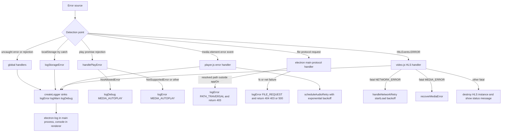

# Centralized Error Handling and Logging

All error detection, classification, logging, and recovery in Oidarwave funnels through one shared hub, `src/js/errors.js`. The same module is loaded as a deferred browser script in every page (`index.html`, `video/index.html`, …) and `require()`d by the Electron main process (`electron/main.js`), so renderer and main process share one `ErrorCode` taxonomy and one set of leveled loggers. Scripts are loaded in the fixed order `errors.js` → `player-core.js` → page module (`player.js` or `video.js`), and `errors.js` additionally exposes its API both as `window.*` globals and via `module.exports` for Electron.

Related pages: [Architecture Overview](../architecture/overview.md), [Persistence](../architecture/persistence.md), [Electron Integration](../integrations/electron.md), [Playback Workflow](playback.md).

## Error Code Taxonomy

`ErrorCode` is a frozen map of symbolic names to string values (`src/js/errors.js#L46-L74`), grouped here by domain:

| Domain | Codes | Primary emitters |
| --- | --- | --- |
| Storage | `STORAGE_READ` (`STORAGE_READ_FAILED`), `STORAGE_WRITE` (`STORAGE_WRITE_FAILED`) | `PlayerCore` storage helpers (`player-core.js#L156-L202`), `history.js` |
| Metadata | `METADATA_FETCH` (`METADATA_FETCH_FAILED`) | `player.js` metadata polling |
| Media / autoplay | `MEDIA_AUTOPLAY` (`MEDIA_AUTOPLAY_BLOCKED`) | `handlePlayError` from every `play().catch()` |
| HLS | `HLS_NETWORK`, `HLS_MEDIA`, `HLS_FATAL`, `HLS_KEY_ERROR`, `HLS_MUX_ERROR` | `video.js` `Hls.Events.ERROR` handler |
| Electron file / navigation | `PATH_TRAVERSAL` (`PATH_TRAVERSAL_BLOCKED`), `FILE_REQUEST` (`FILE_REQUEST_FAILED`), `NPMIGNORE_READ`, `PAGE_DISCOVERY`, `INVALID_NAVIGATION_URL` | `electron/main.js` `protocol.handle`, page discovery, navigation guards |
| Player / reconnect | `PLAYER_INIT_NO_ELEMENT`, `PLAYER_MEDIA_ERROR`, `AUDIO_RECONNECT_RETRY`, `AUDIO_RECONNECT_FAILED` | `player.js`, `video.js` init |
| Favorites | `FAVORITE_LOAD`, `FAVORITE_SAVE`, `FAVORITE_DUPLICATE_ID`, `FAVORITE_DUPLICATE_URL`, `FAVORITE_NOT_FOUND` | `favorite.js` |
| Media Session | `MEDIA_SESSION_SETUP` (`MEDIA_SESSION_SETUP_FAILED`) | `player-core.js` `setupMediaSession`, `video.js` play-state debug logs |
| Download history | `DOWNLOAD_HISTORY` (`DOWNLOAD_HISTORY_FAILED`) | `download_history.js` |
| Global | `UNHANDLED_ERROR`, `UNHANDLED_REJECTION` | `initGlobalErrorHandlers`, `initMainProcessErrorHandlers` |

`HlsErrorMap` (`src/js/errors.js#L76-L85`) additionally maps `Hls.ErrorTypes` (`NETWORK_ERROR`, `MEDIA_ERROR`, `KEY_ERROR`, `MUX_ERROR`) to the `HLS_*` code names; it is built only when the global `Hls` is present (i.e. on the video page) and is empty otherwise.

## Logger Plumbing

### Log levels and threshold

- `LOG_LEVELS` freezes the levels `DEBUG: 0`, `INFO: 1`, `WARN: 2`, `ERROR: 3` (`src/js/errors.js#L1`).
- `parseLogLevelName` parses a case-insensitive level name, returning `undefined` for unknown values (`src/js/errors.js#L4-L8`).
- `getLogLevel` resolves the effective level in order: `window.LOG_LEVEL` → `localStorage.getItem('logLevel')` → default `WARN`; a blocked `localStorage` (private mode) falls through to the default (`src/js/errors.js#L10-L23`). The resolved level is captured once at script load into `currentLogLevel` (`src/js/errors.js#L25`), so changing `localStorage.logLevel` takes effect on the next page load, not at runtime.
- `shouldLog(level)` gates every log call: a message is emitted only if `level >= currentLogLevel` (`src/js/errors.js#L27-L29`).

### Log entry format and output

- `formatLogEntry(code, err, ctx, timestamp)` builds a structured entry `{ timestamp, code, message, name, ...ctx }` with an ISO timestamp, `code` defaulting to `'UNKNOWN'`, and `err.stack` appended when `err` is an `Error` with a stack (`src/js/errors.js#L32-L44`).
- `createLogger(method, level)` produces `logError` / `logWarn` / `logInfo` / `logDebug` (`src/js/errors.js#L101-L117`). Each applies the level filter, then calls the sink as `log[method]('[CODE]', entry)` when a string code is given, or `log[method](entry)` without one.
- The sink comes from `getLogger()`: if `typeof module !== 'undefined'`, the module tries `require('electron-log')` in a `try/catch` and uses it when available (Electron main process); otherwise it uses `console` (`src/js/errors.js#L87-L98`). In the renderer this means `console`, so `window.LOG_LEVEL = 'DEBUG'` (or `localStorage.logLevel`) is what makes debug output visible in DevTools.
- The API is attached to `window` (`ErrorCode`, `HlsErrorMap`, the four loggers, `handlePlayError`, `logStorageError`, `initGlobalErrorHandlers`) and `initGlobalErrorHandlers()` is invoked immediately in browser environments (`src/js/errors.js#L177-L188`); in module environments everything is exported via `module.exports` including `initMainProcessErrorHandlers` (`src/js/errors.js#L190-L203`).

### Defensive wiring in `player-core.js`

Because `player-core.js` is loaded right after `errors.js` and shared by all pages, it does not capture the logger functions at load time. Instead it resolves them lazily on every call: `getLogFn(name, fallback)` binds `window[name]` if it is a function, `errorCodeSafe(name, fallback)` reads `window.ErrorCode[name]`, and `logStorageErrorSafe` / `handlePlayErrorSafe` fall back to `console.error` when the globals are absent (`src/js/player-core.js#L6-L30`). This keeps logging correct even if `errors.js` loads later than expected, and `player-core.js` itself is the single `try/catch` boundary for all `localStorage` access (`readSetting`/`writeSetting`/`readJSON`/`writeJSON`/`removeSetting`, `player-core.js#L156-L202`), reporting failures through `logStorageErrorSafe` with `STORAGE_READ`/`STORAGE_WRITE`.

## Classification Helpers

### `handlePlayError(e, context)` — play()/autoplay failures

Every `media.play()` promise in the app is routed through `handlePlayError` (audio player `player.js#L138-L141`, HLS manifest parsed / native HLS / visibility resume in `video.js#L134-L140`, `#L205-L218`, `#L259-L267`, and Media Session action handlers in `player-core.js#L70-L72`). It classifies by error name (`src/js/errors.js#L120-L132`):

- `NotAllowedError` → `logDebug(ErrorCode.MEDIA_AUTOPLAY, …)` with `reason: 'Browser policy blocked autoplay (missing user gesture)'` — autoplay blocking is expected without a user gesture, so it is logged at debug level and never surfaces as an error.
- `NotSupportedError` → `logError(ErrorCode.MEDIA_AUTOPLAY, …)` with `reason: 'Browser does not support playback'`.
- Any other error → `logError(ErrorCode.MEDIA_AUTOPLAY, …)` with `reason: <name>`.

### `logStorageError(code, err, key)` — storage failure typing

`getStorageErrorType` types the failure as `QUOTA_EXCEEDED` (`QuotaExceededError` or legacy `code === 22`), `SECURITY_ERROR`, or `UNKNOWN` (`src/js/errors.js#L134-L139`); `logStorageError` then emits `logError(code, err, { key, type })` (`src/js/errors.js#L141-L143`). All `PlayerCore` storage helpers call it from their `catch` blocks, so quota and privacy-mode failures are distinguishable in the logs.

## Global Handlers

### Renderer (`initGlobalErrorHandlers`, auto-invoked on load)

- `window.onerror` logs uncaught exceptions as `UNHANDLED_ERROR` with `source`, `lineno`, `colno`, and the message (`src/js/errors.js#L149-L156`).
- `window.addEventListener('unhandledrejection', …)` wraps non-`Error` rejection reasons in an `Error` and logs them as `UNHANDLED_REJECTION` (`src/js/errors.js#L158-L161`).

### Electron main process (`initMainProcessErrorHandlers`)

`electron/main.js` requires `ErrorCode`, `logError`, `logWarn`, and `initMainProcessErrorHandlers` from `../src/js/errors.js` and calls the initializer at startup (`electron/main.js#L10-L11`). It registers `process.on('unhandledRejection')` → `UNHANDLED_REJECTION` and `process.on('uncaughtException')` → `UNHANDLED_ERROR` (`src/js/errors.js#L164-L175`). Because `module` exists in the main process, `getLogger()` resolves `electron-log`, whose file and console transports are set to `debug` level in `electron/main.js#L5-L8` — so the main process logs everything regardless of the renderer threshold.

## Error Classification and Routing

Error classification and routing from detection point to log sink and recovery action.

## Representative Flows

### Audio media error → log → retry (`player.js`)

1. The `error` event on `#audioPlayer` fires; the handler logs `PLAYER_MEDIA_ERROR` with the `MediaError` code/message, current `src`, and page path (`src/js/player.js#L181-L188`), sets `hasError = true`, resets `isAutoRetry`, stops history tracking, and calls `scheduleAudioRetry()` (`src/js/player.js#L189-L196`).
2. `scheduleAudioRetry` does nothing if playback was not active before the error or the browser is offline; if `retryState.count >= MAX_RETRIES` it calls `showExhaustedText()` (logs `AUDIO_RECONNECT_FAILED`, shows a 6-second "Stream nicht erreichbar" message with persistent `error` status class); otherwise it shows the countdown pill (`Versuch n/3 in x s`, logs `AUDIO_RECONNECT_RETRY` at warn level) and schedules `retryAudio` via `PlayerCore.scheduleRetry` (`src/js/player.js#L90-L124`).
3. The backoff itself lives in `PlayerCore`: `getRetryDelay(attempt, base) = base * 2^attempt` and `scheduleRetry` increments the counter when the timer fires, so delays are 1000 / 2000 / 4000 ms for `RETRY_BASE_DELAY = 1000` and `MAX_RETRIES = 3` (`src/js/player-core.js#L206-L238`, constants in `src/js/player.js#L9-L10`). `retryAudio` reloads the element and calls `playMedia()`, whose `play()` rejection goes back to `handlePlayError` (`src/js/player.js#L126-L141`).
4. On the `online` event, an immediate `retryAudio()` is triggered when the player had an error (count capped at `MAX_RETRIES - 1`); the `offline` handler freezes any pending retry timer and switches the status to `error` (`src/js/player.js#L204-L241`).

### HLS errors (`video.js` via `HlsErrorMap`)

`setupHlsJsPlayer` subscribes to `Hls.Events.ERROR`; for each event it builds a context (`type`, `mappedType` from `window.HlsErrorMap`, `fatal`, `details`, `url`, optional `httpStatus`/`httpUrl`/`systemErrorCode`) and logs `HLS_FATAL` for fatal errors or `ErrorCode['HLS_' + mappedType]` otherwise (`src/js/video.js#L141-L148`, `#L151-L166`). Fatal errors then route in `handleFatalHlsError` (`src/js/video.js#L190-L203`):

- `NETWORK_ERROR` → `handleNetworkRetry`: after `MAX_RETRIES` (3) attempts it logs `HLS_NETWORK`, destroys the HLS instance, and shows a persistent network-error message; otherwise it logs a warn and retries `hlsPlayer.startLoad()` with the same exponential backoff (`src/js/video.js#L168-L188`).
- `MEDIA_ERROR` → logs `HLS_MEDIA` (warn) and calls `hlsPlayer.recoverMediaError()`.
- anything else → logs `HLS_FATAL`, destroys the HLS instance, and shows `Schwerwiegender Fehler: …` via the status display.

Non-fatal HLS errors are left to Hls.js itself. If neither Hls.js nor native HLS is supported, `setupHlsPlayer` logs `HLS_FATAL` with `reason: 'HLS not supported by browser'` and shows a permanent "Ihr Browser unterstützt dieses Videoformat nicht." message (`src/js/video.js#L100-L113`).

### Metadata fetch (`player.js`)

Failed metadata polls log `METADATA_FETCH` with `{ metadataUrl, station, type, reason }` (`reason` is `invalid-json` or `network-error` when detectable) and set the song title to "Metadaten nicht verfügbar"; aborted requests (station switch, hidden tab) are ignored (`src/js/player.js#L327-L372`).

### Electron file protocol and navigation (`electron/main.js`)

The custom `file` protocol handler (`electron/main.js#L213-L275`) resolves each request, falls back to app-relative paths for absolute URL pathnames, and confines the result to the app directory: a resolved path outside `appDir` logs `PATH_TRAVERSAL` and returns a 403 JSON response (`electron/main.js#L236-L253`); `ENOENT`/`EACCES`/`EPERM`/other failures log `FILE_REQUEST` and return 404/403/500 JSON (`electron/main.js#L258-L274`). Navigation guards (`will-navigate`, `will-redirect`, `will-frame-navigate`, `setWindowOpenHandler`) prevent bypasses, route `http(s)`/`mailto:` to `shell.openExternal` (logging `INVALID_NAVIGATION_URL` on failure), and load discovered subpages or fall back to `index.html` (`electron/main.js#L150-L205`); page discovery and `.npmignore` read failures log `PAGE_DISCOVERY` and `NPMIGNORE_READ` (`electron/main.js#L30-L102`).

## Recovery and User Feedback Summary

- **Audio**: automatic retry with exponential backoff up to 3 attempts while the stream was playing and the network is up; persistent `error` status plus a short message after exhaustion; immediate retry on `online`; user actions (`selectStation`, `clearAudioRetry`, user pause) reset the retry state; `canplay`/`playing` clear all error flags (`src/js/player.js#L83-L88`, `#L116-L124`, `#L150-L176`).
- **Video (HLS)**: `startLoad()` retries for fatal network errors, `recoverMediaError()` for fatal media errors, destroy + persistent message otherwise.
- **Feedback**: all player pages share `PlayerCore.createStatusDisplay` / `setStatusClass` (`src/js/player-core.js#L40`, `#L96-L152`), which manage the `#statusIndicator` CSS classes (`online`, `error`, `buffering`, `paused`, `text`) and transient text messages, so retry countdowns and fatal-error texts are presented consistently (`src/js/player.js#L70-L114`, `src/js/video.js#L47`, `#L168-L203`).

## Configuration and Extension Points

- **Log level**: set `window.LOG_LEVEL` before the scripts load or `localStorage.logLevel` (applies from the next page load) to any of `DEBUG`/`INFO`/`WARN`/`ERROR`; default `WARN`. In Electron main, `electron-log` transports are independently set to `debug` (`electron/main.js#L5-L8`).
- **Retry parameters**: `MAX_RETRIES` (3) and `RETRY_BASE_DELAY` (1000 ms) in both `player.js` and `video.js`; the backoff formula itself is `PlayerCore.getRetryDelay`.
- **Logger swap**: replace the `require('electron-log')` attempt or `console` in `getLogger()` (`src/js/errors.js#L87-L98`).
- **New error domains**: extend the frozen `ErrorCode` map (`src/js/errors.js#L46-L74`) and, for new HLS error types, `HlsErrorMap` (`src/js/errors.js#L76-L85`); new modules must read them via `window.ErrorCode` / `window.logError` (as `favorite.js`, `history.js`, `download_history.js` do with optional chaining) or via the defensive `player-core.js` helpers.
- **UI feedback**: alter `PlayerCore.createStatusDisplay` or the status class set to change how errors surface.

## Summary

1. **Detection** happens at the point of failure: media element events, HLS error events, `play()` promise rejections, `fetch` catch blocks, `localStorage` `try/catch`, the Electron `file` protocol handler, and global uncaught handlers in both renderer and main process.
2. **Classification** assigns a stable `ErrorCode` string (plus `HlsErrorMap` for HLS types and `getStorageErrorType` for storage failures), with `handlePlayError` keeping expected autoplay blocks out of the error level.
3. **Logging** is centralized in `errors.js`: leveled, level-gated, structured entries (`{timestamp, code, message, name, ...ctx, stack}`) with a `[CODE]` prefix, written to `electron-log` when available (Electron main) and `console` otherwise.
4. **Recovery** uses exponential backoff (`base * 2^attempt`, max 3 attempts) for audio reconnects and HLS network errors, MediaError recovery for HLS, and deterministic teardown + user-facing status messages for fatal cases.
