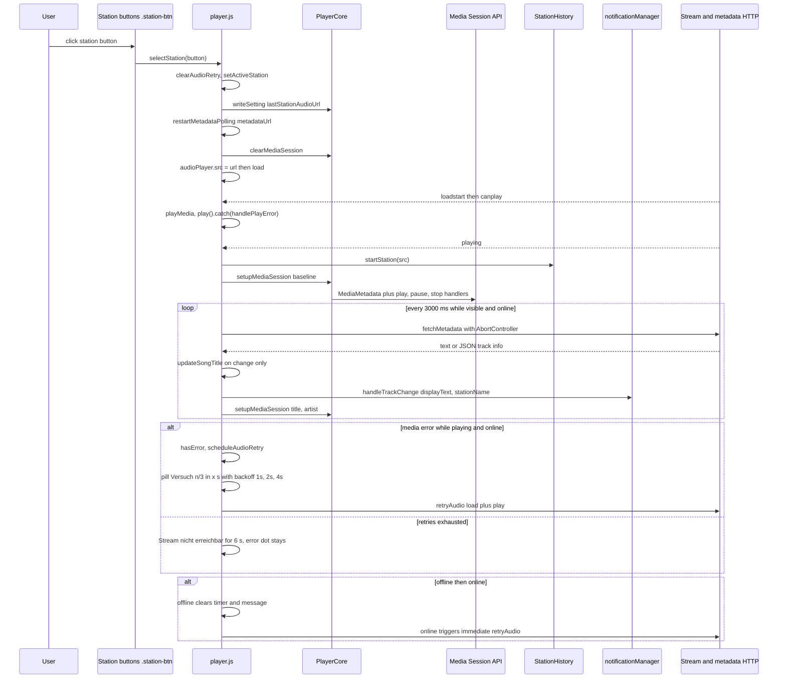

## Overview

The playback workflow covers everything from a click on a `.station-btn` to continuous playback with live metadata, system media controls, listening history, and automatic reconnection. Two pages share one core:

- **Radio page** (`index.html` + `src/js/player.js`): plain HTML5 `<audio id="audioPlayer">` streaming MP3 radio streams, with per-station metadata polling.
- **Video page** (`video/index.html` + `src/js/video.js`): `<video id="videoPlayer">` playing HLS (`.m3u8`) via hls.js (loaded from CDN) with a native Safari fallback.

Both load scripts in the fixed order `errors.js` → `player-core.js` → `notification.js` → page module (`player.js` / `video.js`) → `history.js`, all `defer` (`index.html#L52-L60`, `video/index.html#L55-L63`). Shared behavior (Media Session, status indicator, localStorage helpers, retry/backoff primitives, track formatting) lives in the frozen `window.PlayerCore` object (`src/js/player-core.js#L275-L300`); all logging funnels through `src/js/errors.js` (see [Error Handling](error-handling.md)).

Related pages: [Player Architecture](../architecture/player.md), [Media Session Concept](../concepts/media-session.md), [Notifications](../architecture/notifications.md), [Persistence](../architecture/persistence.md), [Settings](settings.md).

## Station Selection

### Entry point

Station buttons are `<button class="station-btn" data-url="…" data-name="…" [data-metadata-url="…"]>` elements in the station grid (`index.html#L89-L176`, `video/index.html#L92-L123`). Audio buttons may carry a `data-metadata-url`; video buttons only carry `data-url`/`data-name` (`.m3u8` streams).

### Audio: `selectStation(button)` (`player.js#L247-L261`)

Click handler per button (`player.js#L200`). In order:

1. `clearAudioRetry()` — resets the retry state (`resetRetry`: clears timer, `count = 0`), `isAutoRetry = false`, clears the status pill and the indicator `title` (`player.js#L83-L88`).
2. `wasPlayingBeforeError = true` — marks this as a wanted playback so a later stream error is eligible for auto-retry.
3. `setActiveStation(stationButtons, button)` — toggles the `active` class on exactly one button (`player-core.js#L243-L245`).
4. `currentStationDisplay.textContent = name`.
5. `writeSetting(AUDIO_STORAGE_KEY, url)` — persists the URL under the localStorage key `lastStationAudioUrl` (`AUDIO_STORAGE_KEY`, `player.js#L8`) so it can be restored on the next visit.
6. `restartMetadataPolling(metadataUrl)` (`player.js#L263-L272`) — stops the old interval and aborts any in-flight metadata request (`stopMetadataPolling`, `player.js#L280-L291`), stores `currentMetadataUrl`; if no URL is present it shows `Metadaten nicht verfügbar` in the title display, otherwise it fetches immediately (`refreshMetadata`) and starts the 3000 ms interval (`startMetadataInterval`, only when the page is visible).
7. `clearMediaSession()` — drops stale Media Session metadata (`player-core.js#L86-L92`).
8. `currentPlayer.src = url; currentPlayer.load()` — the actual stream load. Playback is **not** started here; it starts on the `canplay` event (see below).

### Restore on load (`player.js#L374-L384`)

At the end of `initializePlayer()`, the last station is restored: `readSetting(AUDIO_STORAGE_KEY)` is matched against the buttons via `button.dataset.url === lastStationUrl` (deliberately not an attribute selector, because URLs contain characters that would need CSS escaping). If a matching button exists it is selected; otherwise the first station button is selected. Either way the page starts playing a station without user interaction (subject to browser autoplay policy, classified by `handlePlayError`).

### Video: `selectStation(button)` (`video.js#L235-L246`)

1. `statusDisplay.clearMessage()` — clears any status text.
2. `currentStationDisplay.textContent = button.dataset.name`.
3. `setupHlsPlayer(button.dataset.url)` — tears down any previous HLS instance (`destroyHlsPlayer`), resets the retry state, disables all text tracks, then branches: `window.Hls.isSupported()` → hls.js path; else `videoPlayer.canPlayType('application/vnd.apple.mpegurl')` → native Safari path; else logs `HLS_FATAL` and shows the persistent message `Ihr Browser unterstützt dieses Videoformat nicht.` (`video.js#L100-L113`).
4. `setupMediaSession({ title: name, artist: 'Livestream', album: 'Oidarwave Video', media: videoPlayer, onStop: clearMediaSession })`.

The video page has **no last-station restore**; on load it always selects the first button (`video.js#L297-L304`).

## Media Events and Playback Initiation (audio)

`player.js` registers handlers for `loadstart`, `canplay`, `playing`, `pause`, `waiting`, and `error` on the `<audio>` element (`player.js#L145-L198`):

- **loadstart**: `isStalled = false`, `updateOverallStatus()`.
- **canplay**: if still paused, `playMedia()` → `currentPlayer.play().catch((e) => handlePlayError(e, 'audio-player'))` (`player.js#L138-L141`); then resets `isStalled`/`hasError`/`isAutoRetry`, calls `clearAudioRetry()`, `updateOverallStatus()`. This is where automatic playback actually begins after `src`/`load()`.
- **playing**: resets the same flags, sets `wasPlayingBeforeError = true`, `StationHistory.startStation(currentPlayer.src)` (opens a new history session, finalizes the previous station's open session), and `updateMediaSession('', '')` — a baseline Media Session (defaults `Livestream` / `Oidarwave Radio`, album = station name) that the metadata poll later overwrites.
- **pause**: if there is no error, a user pause cancels pending retries (`wasPlayingBeforeError = false`, `clearAudioRetry()`); always `StationHistory.stopStation(src)` (closes the open session; sessions shorter than `MIN_SESSION_MS = 1000` ms are discarded as misfires, `history.js#L6-L7`, `#L85-L93`) and `updateOverallStatus()`.
- **waiting**: `isStalled = true` → status `buffering`.
- **error**: logs `PLAYER_MEDIA_ERROR` with the `MediaError` code/message/src, sets `hasError = true`; if this was not an auto-retry, `clearAudioRetry()` starts a fresh sequence; `StationHistory.stopStation(src)`; then `scheduleAudioRetry()`.

`updateOverallStatus()` (`player.js#L70-L81`) derives one status class — `error` if `!navigator.onLine || hasError`, else `paused`, else `buffering` if stalled, else `online` — but never overwrites a visible message pill (`statusDisplay.hasMessage()`), so a retry countdown keeps its styling and lifetime.

Keyboard controls (`player.js#L307-L323`): `Space` toggles play/pause, `ArrowUp`/`ArrowDown` adjust volume by `VOLUME_STEP = 0.1` clamped to `[0, 1]` with 1-decimal precision (`clamp`); shortcuts are ignored when the event target is an editable element (`isEditableTarget`, `player-core.js#L248-L253`).

## Metadata Polling, Title Display, Notifications (audio only)

- Interval: `METADATA_REFRESH_INTERVAL = 3000` ms (`player.js#L5`). `startMetadataInterval()` only runs when a metadata URL exists **and** the page is visible; `refreshMetadata()` additionally bails when offline (`player.js#L275-L296`).
- `fetchMetadata(metadataUrl)` (`player.js#L327-L359`) wraps each request in a fresh `AbortController` and aborts the previous one, so a late response from the old station can never overwrite the new station's title. `.txt` URLs are parsed as text (first line = title, no artist); everything else is parsed as JSON and normalized by `getMusicInfo` (`player-core.js#L261-L265`): title from `song_now_title` or `playlistItem.title`, artist from `name`, `subtitle`, `song_now_interpret`, or `playlistItem.artist`. `formatTrackDisplay` renders `title - artist` (`player-core.js#L268-L271`).
- On success: `updateSongTitle` writes `#currentSongTitle` only when the text actually changed (avoids layout/paint churn on every poll, `player.js#L299-L303`); `window.notificationManager?.handleTrackChange(displayText, stationName())` fires track-change notifications (see below); `updateMediaSession(title, artist)` pushes the track into the Media Session (album = station name).
- On failure (non-abort): `logError(ErrorCode.METADATA_FETCH, …)` with a context built by `buildMetadataErrorContext` (`invalid-json` / `network-error` classification, `player.js#L361-L372`), title display set to `Metadaten nicht verfügbar`, and `clearMediaSession()`.
- Abort errors (station switch, tab hidden) are deliberately ignored (`player.js#L349-L352`).

`notification.js` only activates on the audio page (it hides the toggle when `#audioPlayer` is absent, `notification.js#L16-L22`). `handleTrackChange(newTitle, stationName)` (`notification.js#L87-L102`) skips empty/fallback titles (`Keine Titelinformationen`, `Metadaten nicht verfügbar`), silently adopts a station change without notifying, and otherwise debounces 2000 ms before `sendNotification` shows a `Notification` (`Oidarwave - Neuer Titel`, body `title\nSender: station`, tag `oidarwave-notification`, auto-close after 10 s). The enabled flag is persisted under the localStorage key `notificationsEnabled` and requires `Notification.permission === 'granted'`.

## Media Session Integration

`PlayerCore.setupMediaSession({ title, artist, album, media, onStop })` (`player-core.js#L59-L84`) is the single integration point for both players:

- Skips entirely when `navigator.mediaSession` is unavailable.
- De-duplicates via `lastMediaSessionKey` (`title|artist|album`), so the 3 s poll does not rebuild identical `MediaMetadata` objects.
- Sets `MediaMetadata` with fallbacks `Livestream` / `Oidarwave Radio` / `Oidarwave` and artwork from `FAVICON_ARTWORK` (the SVG favicon at 128/256/512, `player-core.js#L34-L38`).
- Registers action handlers: `play` → `media.play().catch(handlePlayErrorSafe(e, 'media-session'))`, `pause` → `media.pause()`, `stop` → pause + `onStop?.()` (both players pass `clearMediaSession`).
- `clearMediaSession()` (`player-core.js#L86-L92`) resets the key and sets `navigator.mediaSession.metadata = null`; the audio player calls it on station change and metadata failure.

## Error Handling and Auto-Retry (audio)

Constants: `MAX_RETRIES = 3`, `RETRY_BASE_DELAY = 1000` (`player.js#L9-L10`). The backoff primitive `getRetryDelay(count, base) = base * 2^count` yields 1 s, 2 s, 4 s (`player-core.js#L209`); `scheduleRetry` increments `count` when the timer fires (`player-core.js#L230-L238`).

Flow on a media `error` event (`player.js#L181-L196` → `scheduleAudioRetry`, `player.js#L116-L124`):

1. `scheduleAudioRetry()` runs only if `wasPlayingBeforeError && navigator.onLine` — i.e. the stream was actively playing (or the user just chose a station) and the browser reports connectivity.
2. If `retryState.count >= MAX_RETRIES`: `showExhaustedText()` — logs `AUDIO_RECONNECT_FAILED`, shows the pill `Stream nicht erreichbar` for 6000 ms with next status `error` (the red status dot persists as the durable error indicator afterwards), and sets the indicator `title` to `Keine Verbindung zum Stream – bitte Sender neu wählen` (`player.js#L107-L114`).
3. Otherwise `showRetryText()` logs `AUDIO_RECONNECT_RETRY` and shows a persistent (`duration 0`) `buffering` pill `Versuch n/3 in x s` plus a matching `title`, then `scheduleRetry(retryState, retryAudio, RETRY_BASE_DELAY)`.
4. `retryAudio()` (`player.js#L126-L136`): guards on `src`, clears `hasError`, sets `isAutoRetry = true` (so the next `error` event does not reset the count), dissolves the countdown pill immediately, `load()` + `playMedia()`.
5. `canplay` clears all error/retry state (`clearAudioRetry()`), so a successful retry ends the sequence.

**Network transitions** (`player.js#L204-L241`):

- `offline`: clears a pending retry timer (count is kept for resume), removes the message/`title`, updates status (→ `error` via `!navigator.onLine`), stops the history session.
- `online`: refreshes metadata immediately; if `hasError && wasPlayingBeforeError && src`, clamps `retryState.count` to `MAX_RETRIES - 1` if exhausted, clears any pending timer, and calls `retryAudio()` immediately (counts as one attempt); otherwise just `updateOverallStatus()`.
- `visibilitychange`: when the tab is hidden, metadata polling stops (interval cleared **and** in-flight fetch aborted); when visible again, metadata is refreshed immediately and the interval restarts (`player.js#L219-L226`).

`play()` failures never surface as unhandled rejections: every call is wrapped in `.catch((e) => handlePlayError(e, …))`, which classifies `NotAllowedError` (autoplay blocked) as debug-level `MEDIA_AUTOPLAY` and everything else as an error (`errors.js#L120-L132`).

## Video Player Contrast (`video.js`)

- **hls.js path** (`setupHlsJsPlayer`, `video.js#L122-L149`): sets `crossorigin="anonymous"` on the video element, constructs `new Hls({ xhrSetup: (xhr) => { xhr.withCredentials = false } })` (no credentials, avoids CORS issues), `loadSource(url)` + `attachMedia(videoPlayer)`. On `MANIFEST_PARSED` (guarded by an instance-identity check so a destroyed instance cannot fire): clear status, `videoPlayer.play().catch(handlePlayError(e, 'manifest-parsed'))`, `updateQualityLevel()`, `applyCaptions()`. On `Hls.Events.ERROR`: the error `type` is mapped through `window.HlsErrorMap` (`Hls.ErrorTypes.NETWORK_ERROR/MEDIA_ERROR/KEY_ERROR/MUX_ERROR` → `HLS_*` names, `errors.js#L76-L85`) to pick the log code (`HLS_FATAL` if fatal, else `ErrorCode['HLS_' + mappedType] || 'HLS_ERROR'`); only fatal errors trigger recovery — non-fatal errors are left to hls.js itself.
- **Fatal error recovery** (`handleFatalHlsError`, `video.js#L190-L203`): `NETWORK_ERROR` → `handleNetworkRetry` (same exponential backoff, `MAX_RETRIES = 3`, retry via `hlsPlayer.startLoad()`; when exhausted the HLS instance is destroyed and a persistent message `Netzwerkfehler: Nach 3 Versuchen keine Verbindung…` is shown, `video.js#L168-L188`); `MEDIA_ERROR` → `hlsPlayer.recoverMediaError()`; anything else → destroy + persistent `Schwerwiegender Fehler: …` message.
- **Native Safari HLS** (`setupNativePlayer`, `video.js#L205-L218`): removes `crossorigin` (streams without CORS headers would fail), sets `src` directly, and on a one-shot `loadedmetadata` clears status, plays, and applies captions.
- **Data-save mode**: toggle persisted under localStorage key `dataSaveMode`; `updateQualityLevel()` sets `hlsPlayer.currentLevel = 0` (lowest) when enabled, `-1` (auto) otherwise (`video.js#L74-L77`, `#L227-L231`).
- **Captions**: persisted under `captionsEnabled`; `applyCaptions()` sets `hlsPlayer.subtitleDisplay` and the mode of the first track whose kind is `subtitles`/`captions`/`metadata` (`CAPTION_TRACK_KINDS`) to `showing`/`disabled`; an `addtrack` listener auto-disables new tracks while captions are off (`video.js#L59-L96`).
- **Seek**: `ArrowLeft`/`ArrowRight` and the `#rewindButton`/`#forwardButton` buttons seek ±`SEEK_TIME = 10` s, clamped to `[0, duration]` (`video.js#L222-L225`, `#L256-L257`, `#L280-L289`).
- **Lifecycle**: `visibilitychange` to visible resumes playback if not paused (`video.js#L259-L267`); `pause`/`playing` only emit debug logs. Video does not poll metadata and does not write `StationHistory`.

## End-to-End Sequence (radio page)

Sequence: click → `selectStation` (retry cleared, station persisted as `lastStationAudioUrl`, metadata polling restarted, Media Session cleared, `src`/`load`) → `canplay` → `playMedia()`/`play().catch(handlePlayError)` → `playing` → `StationHistory.startStation` + baseline Media Session → 3000 ms metadata loop with `AbortController` → `updateSongTitle` → `notificationManager.handleTrackChange` → `setupMediaSession`; on error → backoff retry → exhausted state; offline/online switch retry and polling.

## Invariants and Failure Semantics

- Exactly one station button carries `active`; the radio page always has a station selected (restored `lastStationAudioUrl` or first button), the video page always selects the first button on load.
- Retry only happens when playback was wanted (`wasPlayingBeforeError`) and the browser is online; a user pause or a manual station change resets the sequence (`isAutoRetry` distinguishes automatic from user attempts).
- At most `MAX_RETRIES = 3` automatic attempts per error sequence; exhaustion leaves a persistent `error` status dot after the 6 s message.
- Metadata polling never runs while the tab is hidden or offline, and an aborted in-flight request is ignored, so a stale response can never overwrite the current station's title.
- The Media Session is de-duplicated by a key and cleared on station change and metadata failure; artwork always comes from `FAVICON_ARTWORK`.
- History sessions shorter than 1 s are discarded; open sessions are finalized on pause/error/offline/station change (`history.js#L85-L137`).
- All `play()` promises are caught and classified by `handlePlayError`; autoplay blocking is debug-level, not an error.
