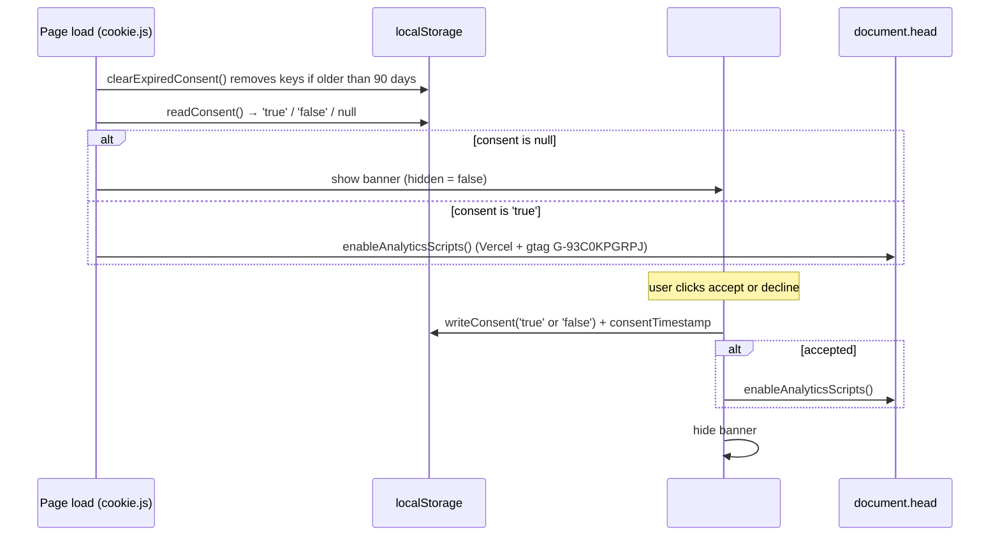
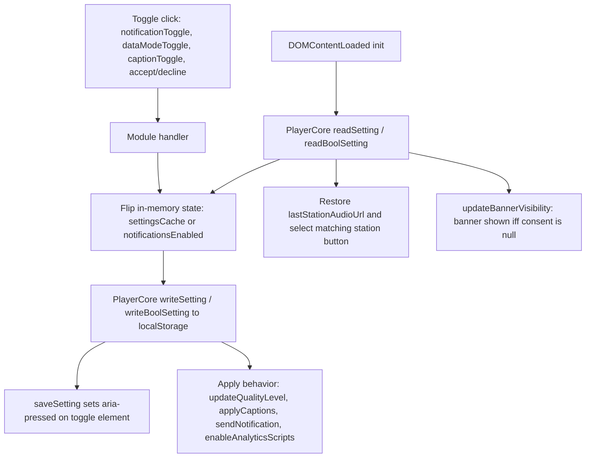

## Overview

The settings workflow traces every user preference from its UI control through the shared `PlayerCore` storage helpers into `localStorage`, and from there into applied behavior. Preferences are grouped into four clusters:

- **Audio player** (`src/js/player.js`): last selected station URL; volume is keyboard-only and never persisted.
- **Video player** (`src/js/video.js`): data save mode and caption enablement, kept in a `settingsCache` and mirrored onto `aria-pressed` toggle buttons.
- **Notifications** (`src/js/notification.js`): track-change notification preference behind `#notificationToggle`.
- **Consent** (`src/js/cookie.js`): cookie/analytics consent behind the `#cookieBanner` accept/decline buttons, with a 90-day expiry. This is deliberately separate from player settings and gates only analytics scripts.

All `localStorage` access for settings goes through `PlayerCore` (except `logLevel` in `errors.js`, see below); every read/write is wrapped in `try/catch` so storage failures (private mode, quota) are logged and never block the UI.

## Persisted Setting Keys

| Key | Written by | Read by / consumer | UI element |
| --- | --- | --- | --- |
| `lastStationAudioUrl` | `player.js` `selectStation()` (`repo://src/js/player.js#L255`) | `player.js` startup restore (`repo://src/js/player.js#L376-L384`) | `.station-btn` active state |
| `notificationsEnabled` | `notification.js` `saveNotificationPreference()` (`repo://src/js/notification.js#L57-L59`) | `notification.js` `init()` via `readBoolSetting` (`repo://src/js/notification.js#L24`); gates `sendNotification()` (`repo://src/js/notification.js#L70-L72`) | `#notificationToggle` (`repo://index.html#L185-L191`) |
| `dataSaveMode` | `video.js` `saveSetting()` from `toggleDataSaveMode()` (`repo://src/js/video.js#L227-L231`) | `video.js` `settingsCache` init (`repo://src/js/video.js#L48-L51`); drives `updateQualityLevel()` (`repo://src/js/video.js#L74-L77`) | `#dataModeToggle` with `aria-pressed` (`repo://video/index.html#L124-L126`) |
| `captionsEnabled` | `video.js` `saveSetting()` from `toggleCaptions()` (`repo://src/js/video.js#L87-L91`) | `video.js` `settingsCache` init (`repo://src/js/video.js#L50`); drives `applyCaptions()` (`repo://src/js/video.js#L80-L85`) and the `addtrack` listener (`repo://src/js/video.js#L60-L62`) | `#captionToggle` with `aria-pressed` (`repo://video/index.html#L127`) |
| `cookieConsent` | `cookie.js` `writeConsent()` (`repo://src/js/cookie.js#L15-L19`) | `cookie.js` `updateBannerVisibility()` (`repo://src/js/cookie.js#L64-L68`); gates `enableAnalyticsScripts()` | `#cookieBanner` + `#acceptCookies` / `#declineCookies` (`repo://index.html#L231-L251`, `repo://video/index.html#L159-L179`) |
| `consentTimestamp` | `cookie.js` `writeConsent()` (`repo://src/js/cookie.js#L18`) | `cookie.js` `clearExpiredConsent()` 90-day expiry check (`repo://src/js/cookie.js#L21-L29`) | none (internal) |
| `logLevel` | external (dev tools / other code) | `errors.js` `getLogLevel()` reads `localStorage` directly, default `WARN` (`repo://src/js/errors.js#L10-L25`) | none (internal) |

## Storage Layer: PlayerCore (player-core.js)

`src/js/player-core.js` is the single place with `try/catch` around `localStorage` (`repo://src/js/player-core.js#L154-L202`) and exports a frozen `PlayerCore` object on `window` (`repo://src/js/player-core.js#L275-L304`):

- `readSetting(key)` — returns the string value or `null` on missing key or storage error (`repo://src/js/player-core.js#L156-L163`).
- `readBoolSetting(key)` — `true` only when the stored string is exactly `'true'` (`repo://src/js/player-core.js#L165`).
- `writeSetting(key, value)` — stores `String(value)`; failures are logged via `logStorageError` and swallowed (`repo://src/js/player-core.js#L167-L173`).
- `writeBoolSetting(key, value)` — stores `String(Boolean(value))` (`repo://src/js/player-core.js#L175`).
- `readJSON` / `writeJSON` / `removeSetting` — same pattern for JSON values and removal (`repo://src/js/player-core.js#L177-L202`).

It also owns shared UI helpers used by the settings flow: `isEditableTarget` (keyboard shortcuts are ignored when focus is in an `INPUT`/`TEXTAREA`/`SELECT`/`BUTTON` or a content-editable element, `repo://src/js/player-core.js#L248-L253`) and `clamp(value, min, max, precision)` (`repo://src/js/player-core.js#L255-L258`).

## Audio Player Settings (player.js)

### Volume (session-only)

- **Initialization**: `currentPlayer.volume = 1` on every session start (`repo://src/js/player.js#L40`). Volume is **never written to `localStorage`**, so it resets to `1.0` on each page load.
- **Keyboard adjustment** (`handleKeyDown`, `repo://src/js/player.js#L307-L323`): `ArrowUp`/`ArrowDown` change the volume by `±0.1` (`VOLUME_STEP`) and assign `clamp(volume ± step, 0, 1, 1)` — clamped to `[0, 1]` with one-decimal precision (`repo://src/js/player.js#L315-L321`, `repo://src/js/player-core.js#L255-L258`). `Space` toggles play/pause (`repo://src/js/player.js#L310-L314`).
- **Guard**: the whole handler returns early when `isEditableTarget(e.target)` is true, so typing in form fields or focused buttons never triggers volume or playback shortcuts (`repo://src/js/player.js#L308`).

### Last Station (persisted)

- **Key**: `AUDIO_STORAGE_KEY = 'lastStationAudioUrl'` (`repo://src/js/player.js#L8`).
- **Write**: `selectStation()` persists the chosen URL via `writeSetting(AUDIO_STORAGE_KEY, url)` (`repo://src/js/player.js#L255`).
- **Read/restore**: on `DOMContentLoaded`, the stored URL is read with `readSetting` and matched against station buttons by `dataset.url` (not by CSS attribute selector, because URLs contain selector-hostile characters); a match is auto-selected, otherwise the first station starts (`repo://src/js/player.js#L376-L384`).

## Video Player Settings (video.js)

### settingsCache pattern

At `DOMContentLoaded` both boolean settings are read once into an in-memory cache (`repo://src/js/video.js#L48-L51`):

```js
const settingsCache = {
    dataSaveMode: readBoolSetting(DATA_SAVE_MODE_KEY),
    captionsEnabled: readBoolSetting(CAPTION_ENABLED_KEY),
}
```

Every toggle handler follows the same three-step pattern — flip the cache, persist + sync the button, apply the behavior:

1. Invert the cached boolean (`repo://src/js/video.js#L228`, `repo://src/js/video.js#L88`).
2. Persist via `saveSetting(key, value, toggleElement)`, which sets `aria-pressed` on the toggle element **and** calls `PlayerCore.writeSetting` (`repo://src/js/video.js#L54-L57`). This keeps the accessible state and storage in one place.
3. Apply immediately (`updateQualityLevel()` / `applyCaptions()`).

At init, `initializePlayer()` sets `aria-pressed` on `#dataModeToggle` from the cache and `initializeCaptions()` does the same for `#captionToggle` before applying (`repo://src/js/video.js#L93-L96`, `repo://src/js/video.js#L297-L301`), so the buttons reflect stored preferences on every load.

### Data Save Mode → HLS quality

- **Key**: `dataSaveMode` (`repo://src/js/video.js#L6`).
- **Toggle**: `#dataModeToggle` click → `toggleDataSaveMode()` (`repo://src/js/video.js#L227-L231`, listener at `repo://src/js/video.js#L254`).
- **Application**: `updateQualityLevel()` sets `hlsPlayer.currentLevel = 0` (lowest rendition) when data save mode is on, and `-1` (automatic ABR) when off; it is a no-op until levels exist (`repo://src/js/video.js#L74-L77`). It is called on toggle and after `MANIFEST_PARSED` (`repo://src/js/video.js#L138`).

### Captions Enabled → text tracks

- **Key**: `captionsEnabled` (`repo://src/js/video.js#L7`); track kinds considered are `subtitles`, `captions`, `metadata` (`repo://src/js/video.js#L8`).
- **Toggle**: `#captionToggle` click → `toggleCaptions()` (`repo://src/js/video.js#L87-L91`, listener at `repo://src/js/video.js#L255`).
- **Application**: `applyCaptions()` is the single application point (`repo://src/js/video.js#L80-L85`): it sets `hlsPlayer.subtitleDisplay` for HLS.js, sets the first matching text track's `mode` to `'showing'`/`'disabled'`, and — if captions are enabled but no track exists yet — disables all text tracks so nothing shows unexpectedly (`disableAllTextTracks`, `repo://src/js/video.js#L66-L69`).
- **Late-arriving tracks**: an `addtrack` listener on `videoPlayer.textTracks` sets any newly added track to `mode = 'disabled'` while captions are off (`repo://src/js/video.js#L60-L62`), so tracks added after manifest load never appear against the user's preference. `applyCaptions()` is also re-run on `MANIFEST_PARSED` and native `loadedmetadata` (`repo://src/js/video.js#L139`, `repo://src/js/video.js#L214`).

## Notification Toggle (notification.js)

- **Key**: `notificationsEnabled`, read at `init()` via `PlayerCore.readBoolSetting('notificationsEnabled')` (default `false`) and written via `writeSetting` in `saveNotificationPreference()` (`repo://src/js/notification.js#L24`, `repo://src/js/notification.js#L57-L59`).
- **Toggle flow**: `#notificationToggle` click → `toggleNotifications()`; enabling first ensures the browser `Notification` permission is granted (alerting if permanently denied), then flips the flag, persists, and updates the UI (`repo://src/js/notification.js#L29-L55`).
- **UI sync**: unlike the video toggles, this button uses the `active` class, `title`, and `aria-label` (not `aria-pressed`) in `updateNotificationToggleUI()` (`repo://src/js/notification.js#L61-L68`).
- **Visibility rule**: if the Notification API is unsupported or the page has no `#audioPlayer` (i.e. the video page), the toggle is hidden with `style.display = 'none'` (`repo://src/js/notification.js#L19-L22`). The applied behavior is `sendNotification()` on track changes (2 s debounce via `handleTrackChange()`), which returns early unless the persisted preference is on and permission is granted (`repo://src/js/notification.js#L70-L102`). See [Notifications](../architecture/notifications.md).

## Cookie Consent Flow (cookie.js)

Consent is managed end-to-end in `src/js/cookie.js`, separately from player settings, and only gates analytics — it never influences player behavior.

1. **Startup** (IIFE bottom, `repo://src/js/cookie.js#L82-L84`): `clearExpiredConsent()` → `bindBannerActions()` → `updateBannerVisibility()`.
2. **Expiry**: `clearExpiredConsent()` removes both `cookieConsent` and `consentTimestamp` when the stored timestamp is older than 90 days (`EXPIRY_DAYS = 90`, `repo://src/js/cookie.js#L4-L7`, `repo://src/js/cookie.js#L21-L29`). After removal, consent reads as `null` again and the banner reappears.
3. **Banner visibility**: `updateBannerVisibility()` shows `#cookieBanner` exactly when `readConsent() === null` (no decision yet, or expired) and, if consent is `'true'`, calls `enableAnalyticsScripts()` (`repo://src/js/cookie.js#L64-L68`). Visibility uses the `hidden` attribute (`setBannerVisible`, `repo://src/js/cookie.js#L59-L62`); CSS `[hidden]` remains the only visibility source.
4. **Accept** (`#acceptCookies`): `writeConsent('true')` stores the consent string plus `String(Date.now())` under `consentTimestamp`, then `enableAnalyticsScripts()` runs and the banner is hidden (`repo://src/js/cookie.js#L71-L75`, `repo://src/js/cookie.js#L15-L19`).
5. **Decline** (`#declineCookies`): `writeConsent('false')` stores `'false'` (no scripts are injected) and hides the banner (`repo://src/js/cookie.js#L76-L79`).
6. **Analytics injection**: `enableAnalyticsScripts()` appends, into `document.head`, the Vercel Analytics stub + `/_vercel/insights/script.js`, the Speed Insights stub + `/_vercel/speed-insights/script.js`, and the Google `gtag` bootstrap + `https://www.googletagmanager.com/gtag/js?id=G-93C0KPGRPJ` targeting measurement `G-93C0KPGRPJ` (`repo://src/js/cookie.js#L31-L56`). It is idempotent: if a `/_vercel/insights/script.js` script already exists in `head`, it returns immediately (`repo://src/js/cookie.js#L33`).

The banner markup (`role="dialog"`, `aria-live="polite"`, `#acceptCookies`/`#declineCookies`) exists on both `index.html` (`repo://index.html#L231-L251`) and `video/index.html` (`repo://video/index.html#L159-L179`).



*Cookie consent lifecycle: expiry check, banner visibility rule, accept/decline writes, and analytics injection.*

## Settings Flow (all toggles)



*Every toggle follows the same path: flip cached state, persist via PlayerCore, sync `aria-pressed`, apply behavior immediately; init reads persisted values back into the same cache.*

## Log Level (errors.js)

`src/js/errors.js` reads the `logLevel` key **directly** from `localStorage` (not via `PlayerCore`) at script load: a stored level name is parsed case-insensitively, otherwise it falls back to `WARN`; storage access is wrapped in `try/catch` for blocked storage (`repo://src/js/errors.js#L10-L25`). The resulting `currentLogLevel` gates all `shouldLog()` checks (`repo://src/js/errors.js#L25-L29`). This is the one persisted key outside the `PlayerCore` boundary, because `errors.js` must work before/without `PlayerCore`.

## Initialization and Application Flow

1. **Page load** (`DOMContentLoaded`):
   - `cookie.js` (runs as an IIFE at script parse): expire old consent, bind banner buttons, show banner iff no consent, inject analytics iff consent `'true'`.
   - `player.js`: volume set to `1.0`; `lastStationAudioUrl` read and the matching station button auto-selected (or the first station).
   - `video.js`: `dataSaveMode`/`captionsEnabled` read into `settingsCache`; `aria-pressed` set on both toggles; `applyCaptions()` applied; first station started (which later triggers `updateQualityLevel()` + `applyCaptions()` on `MANIFEST_PARSED`).
   - `notification.js`: `notificationsEnabled` read; toggle UI synced or hidden.
2. **User interaction**:
   - `ArrowUp`/`ArrowDown` adjust volume (not persisted); `Space` toggles play/pause — all skipped when the event target is editable.
   - Station click persists the audio URL and (video) reloads the HLS source.
   - Toggle clicks flip cache + persist + sync `aria-pressed` + apply immediately.
   - Cookie accept/decline writes consent and shows/hides the banner; accept also injects analytics.
3. **State application**: data save mode and captions take effect instantly through direct HLS.js / text-track APIs; notification preference gates `sendNotification()`; consent gates only analytics scripts.

## Session Persistence and Scope

- **Audio**: only `lastStationAudioUrl` persists; volume and play/pause state do not survive reloads.
- **Video**: `dataSaveMode` and `captionsEnabled` persist across sessions and browser restarts.
- **Notifications**: `notificationsEnabled` persists; the browser `Notification.permission` itself is a separate browser-owned grant.
- **Consent**: `cookieConsent` + `consentTimestamp` persist for 90 days, then are removed automatically and the banner returns.
- **Storage scope**: all keys live in `localStorage`, isolated per origin; there is no cross-device sync. Related: [Persistence](../architecture/persistence.md), [UI Architecture](../architecture/ui.md), [Playback Workflow](playback.md).

## Failure Handling

- **Storage errors**: every `PlayerCore` read/write is `try/catch`-guarded; failures log via `logStorageError` (or `console.error` fallback before `errors.js` loads) and return `null`/no-op, so the UI always falls back to defaults (`false`, first station, banner shown) without crashing (`repo://src/js/player-core.js#L12-L19`, `repo://src/js/player-core.js#L156-L202`).
- **Missing elements**: if `#videoPlayer`/`#audioPlayer` or a toggle is absent, the module logs `PLAYER_INIT_NO_ELEMENT` and returns/skips dependent wiring (`repo://src/js/player.js#L36-L39`, `repo://src/js/video.js#L35-L38`, optional chaining on toggles).
- **Missing PlayerCore**: `cookie.js` and `notification.js` degrade gracefully when `window.PlayerCore` is absent (`storage()` returns `null`; `readBoolSetting` falls back to `false`) (`repo://src/js/cookie.js#L9-L13`, `repo://src/js/notification.js#L24`, `repo://src/js/notification.js#L58`).
- **Permission denied**: notification toggle refuses to enable and alerts the user when `Notification.permission === 'denied'`; no preference is persisted in that case (`repo://src/js/notification.js#L44-L50`).
- **Unsupported HLS**: if neither HLS.js nor native Safari HLS is available, `video.js` logs `HLS_FATAL` and shows a static error message (`repo://src/js/video.js#L105-L112`).
